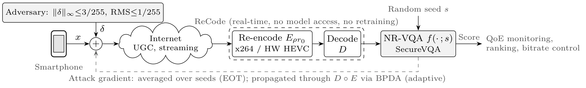
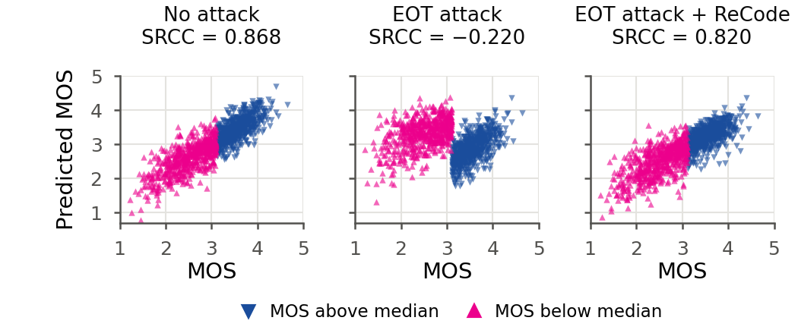

# ReCode

**Real-time, model-agnostic adversarial defense for no-reference video quality assessment (NR-VQA) via inter-frame re-encoding**

Sungman Hong, AI Development Team, LIG Accuver. Paper under review (submitted to IEEE ICCE 2027).

<p align="center"></p>

NR-VQA models that monitor streaming quality can be manipulated by imperceptible adversarial perturbations. We show that SecureVQA, to our knowledge the only defense designed for NR-VQA, is broken by an expectation-over-transformation (EOT) attack that averages the gradient over its test-time randomization. ReCode removes the perturbation from the input instead of hiding the gradient: the received video is re-encoded with an inter-frame codec (x264 on a server, the hardware HEVC encoder on a smartphone) at a fixed fraction ρ of its own bitrate before an unmodified quality model. The quantized residual discards most of the perturbation while the ranking of videos is preserved. No model access, no retraining.

## Results on KoNViD-1k (1200 videos, SecureVQA)

| Setting | SRCC |
|---|---|
| SecureVQA, clean | 0.868 |
| SecureVQA, EOT attack (within its original budget) | −0.220 |
| SecureVQA + ReCode (ρ = 0.5), clean | 0.835 |
| SecureVQA + ReCode (ρ = 0.5), EOT attack | 0.820 |
| SecureVQA + ReCode (ρ = 0.5), adaptive attack (BPDA + EOT through the codec) | 0.819 |
| Frame-wise JPEG at the same quality loss (q = 30), EOT / adaptive attack | 0.753 / 0.706 |

Re-encoding takes 0.17 s per 8-s 540p video with the fastest x264 preset.

<p align="center"></p>

## Planned release

- Attack code: fixed-seed, EOT, and adaptive (BPDA + EOT) attacks on SecureVQA
- ReCode defense wrapper for x264 and for Android MediaCodec (HEVC)
- Per-video results for all 1200 KoNViD-1k videos: video name, MOS, and clean / attacked / defended scores for every x264 preset × rate ratio, frame-wise JPEG, intra-only coding, and TRADES fine-tuning
- Android app that measures hardware HEVC re-encoding on the Samsung Galaxy S24 Ultra

*To be updated.*

## Citation

```bibtex
@inproceedings{hong2027recode,
  title     = {ReCode: Real-Time, Model-Agnostic Adversarial Defense for Video Quality Assessment on Consumer Devices via Inter-Frame Re-encoding},
  author    = {Hong, Sungman},
  booktitle = {IEEE International Conference on Consumer Electronics (ICCE)},
  year      = {2027},
  note      = {under review}
}
```
